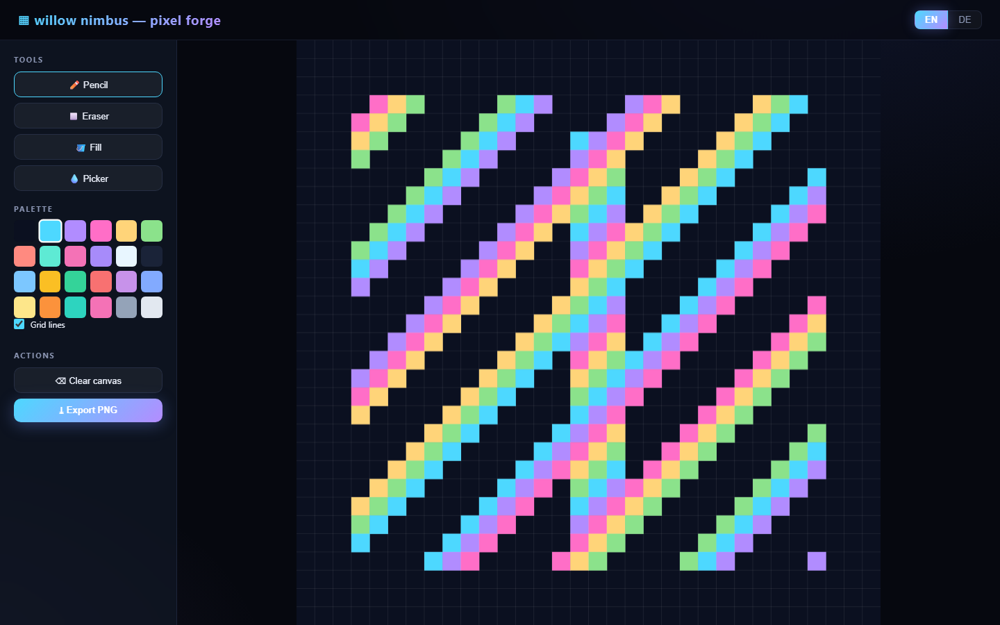
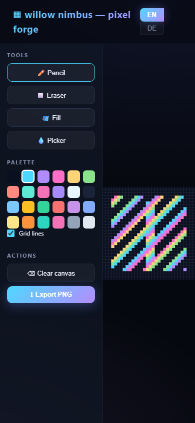

# Willow Nimbus — Pixel Forge

A 32×32 pixel art editor: pencil, eraser, flood fill, color picker, 24-color palette and one-click PNG export. Works with mouse and touch.

<div align="center">


**[Live Demo](https://ruslanfridenli.github.io/willow-nimbus/)** · **[Deutsch ↓](#-deutsch)**

</div>

---

## Screenshots






## Features

- 32×32 pixel canvas
- Pencil, eraser, flood fill and eyedropper
- 24-color curated palette
- Bresenham line drawing
- Grid toggle and clear
- PNG export at native resolution
- English/German interface

## Local development

```bash
git clone https://github.com/ruslanfridenli/willow-nimbus.git
cd willow-nimbus
# open index.html in a browser, or serve statically:
npx serve .
```

No build step, no dependencies — pure static site.

---

## 🇩🇪 Deutsch

### Willow Nimbus — Pixel Forge

Ein 32×32 Pixel-Art-Editor: Stift, Radierer, Füllwerkzeug, Pipette, 24-Farben-Palette und PNG-Export per Klick. Funktioniert mit Maus und Touch.

### Funktionen

- 32×32 Pixel-Leinwand
- Stift, Radierer, Füllen und Pipette
- 24 Farben kuratierte Palette
- Bresenham-Linienzeichnung
- Gitter-Umschalter und Leeren
- PNG-Export in nativer Auflösung
- Englische/deutsche Oberfläche

### Lokale Entwicklung

```bash
git clone https://github.com/ruslanfridenli/willow-nimbus.git
cd willow-nimbus
npx serve .
```

Reine statische Seite — kein Build-Schritt, keine Abhängigkeiten.

---

## ☕ Support / Unterstützen

Wenn dir diese Website beim Lernen hilft, würde mir eine Spende sehr viel bedeuten und dabei helfen, sie weiterzuentwickeln. Alternativ kannst du das Projekt mit einem Stern im github repo unterstützen. Vielen Dank!

- Solana: `zQpgZ6nGigww7vYpz3Qqxb1BT44kqS567vFaLTeHagS`
- Ethereum: `0x9c4fE1B2e9a1A9c22312c8296BB088Ca0e8F1B4e`
- Bitcoin: `bc1p2jltk9ya9kyzv35d8kxn7mmg9jqkx66cqtgzqwe75zlr4v9jk4hsv468q7`

---

Made with care. Feedback welcome via issues.
